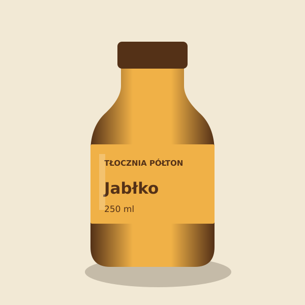

# Tłocznia Półton

Projekt koncepcyjny – marka fikcyjna

Cztery etykiety i makiety butelek fikcyjnej tłoczni soków.

## Overview

A packaging concept for small-batch drinks. Apple, pear, blackcurrant, and cherry share the same grid and differ in color and monogram.

## Files and editing

- `source/`: editable artwork, dieline guides, and SVG bottle mockups.
- `exports/`: full-size 180 × 70 mm vector PDFs and PNG proofs.
- `index.html`: responsive Polish gallery.

Open the SVG files in Inkscape. Adjust the artboard to the bottle supplier's dieline before production. The dashed inner guide is 4 mm inside the nominal trim. The guide is supplied as a separate SVG. The PDF is a vector artwork at nominal trim size with RGB swatches. Convert to your printer's color profile and extend artwork for its required bleed before production. Packaging text is illustrative.

## Technology

Original SVG, HTML, CSS, and Inkscape. No third-party imagery.
